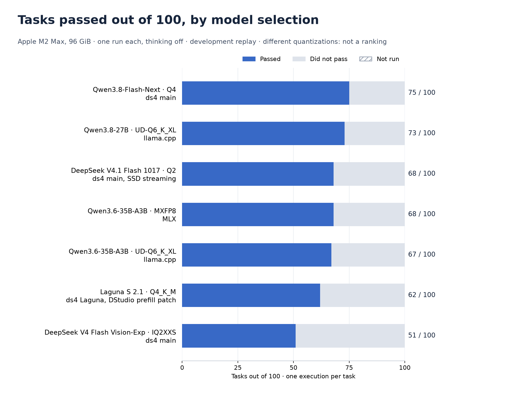

# Common 100-task corpus on the maintainer's Mac

**Work in progress.** This page publishes the reviewed results of the November
2026 campaign ([plan](../../../PLAN.MD)) as they are completed. No model
selection passes the campaign's gate, which requires 100 of 100 tasks. Nothing
here qualifies a model, ranks one engine above another or measures speed.



Each bar is **one run** of the same 100 tasks: one model started alone on an
Apple M2 Max with 96 GiB, thinking off. The selections use different
quantizations and engines, so the bars are not a ranking.

| Selection | Engine | Passed | Did not pass | Not run | Category chart |
| --- | --- | ---: | ---: | ---: | --- |
| Qwen3.8-Flash-Next single-file Q4 | ds4 main `890898c` | 75 | 25 | 0 | [chart](qwen38-next-q4.png) |
| Qwen3.8-27B UD-Q6_K_XL | llama.cpp `b11836` | 73 | 27 | 0 | [chart](qwen27-q6-llama.png) |
| DeepSeek V4.1 Flash 1017 IQ2_XXS/Q2_K, expert SSD streaming | ds4 main `890898c` | 68 | 32 | 0 | [chart](deepseek-v41-1017-q2-ssd.png) |
| Qwen3.6-35B-A3B MXFP8 | MLX (mlx-lm 0.32.2) | 68 | 32 | 0 | [chart](qwen36-mxfp8-mlx.png) |
| Qwen3.6-35B-A3B UD-Q6_K_XL | llama.cpp `b11836` | 67 | 33 | 0 | [chart](qwen36-q6-llama.png) |
| DeepSeek V4 Flash Vision-Exp IQ2XXS | ds4 main `890898c` | 51 | 49 | 0 | [chart](deepseek-v4-vision-exp-iq2xxs.png) |
| Laguna S 2.1 Q4_K_M | ds4 Laguna `448d569` | 51 | 37 | 12 | [chart](laguna-s21-q4.png) |

Every selection that can run on this machine now has a result. Qwen3.8-Flash-Next
Q2 is blocked (no weights on this machine); DeepSeek V4.1 Q4 and GLM 5.3 Flash
are left to contributors with suitable hardware.

DeepSeek V4.1 Flash 1017 is a 366 GB file on a machine with 96 GiB: it runs
only with expert SSD streaming, the one memory mode in which the maintainer
qualifies it, and the run records that mode as effective. Qwen3.8-Flash-Next
keeps its backbone resident and reads its original BF16 n-gram tables from the
SSD.

## What failed

Passed tasks by category (passed / tasks):

| Category | Next Q4 | Qwen3.8-27B | V4.1 1017 Q2 (SSD) | Qwen3.6 MXFP8 (MLX) | Qwen3.6 Q6 (llama.cpp) | DeepSeek V4 Vision-Exp | Laguna S 2.1 |
| --- | ---: | ---: | ---: | ---: | ---: | ---: | ---: |
| Arithmetic and units | 3 / 12 | 2 / 12 | 1 / 12 | 1 / 12 | 5 / 12 | 2 / 12 | 3 / 12 |
| Reasoning | 6 / 12 | 6 / 12 | 6 / 12 | 6 / 12 | 7 / 12 | 7 / 12 | 7 / 12 |
| Writing code | 11 / 15 | 12 / 15 | 10 / 15 | 13 / 15 | 7 / 15 | 0 / 15 | 6 / 15 |
| Fixing bugs | 6 / 10 | 5 / 10 | 6 / 10 | 4 / 10 | 5 / 10 | 1 / 10 | 1 / 10 |
| JSON structure | 10 / 10 | 9 / 10 | 10 / 10 | 9 / 10 | 8 / 10 | 8 / 10 | 9 / 10 |
| Extracting facts | 9 / 10 | 9 / 10 | 9 / 10 | 9 / 10 | 9 / 10 | 7 / 10 | 9 / 10 |
| Following instructions | 9 / 10 | 10 / 10 | 9 / 10 | 8 / 10 | 8 / 10 | 8 / 10 | 8 / 10 |
| Italian and English | 8 / 8 | 8 / 8 | 8 / 8 | 8 / 8 | 8 / 8 | 8 / 8 | 8 / 8 |
| Long texts | 8 / 8 | 7 / 8 | 4 / 8 | 5 / 8 | 5 / 8 | 6 / 8 | 0 / 8 (7 not run) |
| Recognising missing information | 5 / 5 | 5 / 5 | 5 / 5 | 5 / 5 | 5 / 5 | 4 / 5 | 0 / 5 (not run) |

Most failures are answers and formats, not transport: wrong arithmetic, a
correct value wrapped in a JSON object the task did not ask for, code inside
Markdown fences, and replies that are not the requested unified diff. A correct
value in the wrong container **stays failed** and receives no partial credit;
the aggregates count it separately (7 tasks for Next Q4, 10 for Qwen3.8-27B,
7 for V4.1, 6 for Qwen3.6 on MLX, 2 for Qwen3.6 on llama.cpp, 5 for DeepSeek
V4, 6 for Laguna). Every request of the Next Q4, V4.1 and DeepSeek V4 runs
returned a complete answer: none of their failures is a transport or engine
error.

DeepSeek V4 Flash Vision-Exp returned all fifteen programs, and seven of its
ten patches, inside Markdown fences, although each task says to return only
the source or the diff. The grader runs what was returned, so every one of
those fails; the run says nothing about whether the code inside the fences was
correct. All eight of its long texts completed (about five minutes each).

The Laguna run is incomplete. On its first long text the engine answered
HTTP 500 (`metal Laguna prefill failed at token 32768`) and the twelve tasks
after it were not run; they stay in the denominator. That run had no engine
restart between tasks. It belongs to the Laguna engine as it was before
November 11: the cause turned out to be two engine defects, now fixed by
[a DStudio patch](../../../patch/ds4-laguna-prefill-chunk/README.md), so the
patched engine needs its own run; until it has one, this bar shows the
earlier engine.

A diagnostic rerun on the same engine and weights, with an engine restart
after each failed task and no other model or browser job on the machine
(`engine-acceptance/run-tAqoKo`, retained but **not counted**: the first run
is the result), reached 56/100. All eight long texts failed again with HTTP
500 after 78–134 s, now at token 16,384, while the other categories completed
(missing information 5/5). In every case macOS ended the GPU command batch
with `kIOGPUCommandBufferCallbackErrorImpactingInteractivity`, its error for
GPU work that keeps the display from updating, inside the second prefill
batch. Laguna prefills in fixed batches of 16,384 tokens and ignores
`--prefill-chunk`; the second batch also attends to the first 16,384 tokens.
So the failure does not depend on other load. A smaller Laguna prefill batch,
as main has, needs a DStudio patch and a numerical comparison with the
16,384-token batch; that work is open.

## What this measures

A **development replay**: the corpus has been used during development, so this
is not a held-out evaluation. The frozen
[corpus](../../../tests/fixtures/common_model_quality_cases.py) and
[grader](../../../tests/support/common_model_quality.py) check returned
answers, programs and patches against independent expected results. There are
100 tasks in ten categories of unequal size and one execution per task: no
confidence interval is claimed, and a difference of a few tasks between two
bars is not evidence that one selection is better.

It does not run an Agent tool loop, compare agents, check PDF or image
understanding, or establish numerical equivalence with a reference
implementation.

Settings, identical for every run: context capacity 65,536 tokens, temperature
0, seed 20260909, thinking off, at most 2,048 output tokens. Deadlines: 180 s
for ordinary tasks, 240 s for code, 900 s for long texts. Failed tasks are
never retried. Capacity is not a claim that every request used 65,536 tokens.
The machine was shared with model-free test jobs during the runs; these results
must not be used to compare speed.

The two Qwen3.6 runs started from a source tree with uncommitted test-harness
files, which their aggregates record (`hostTreeDirty`); later runs use a clean
tree at a recorded commit.

## Data

Each file in [`results/`](results) is the public aggregate of one run: totals,
category counts, failure classes, settings, the SHA-256 of the weights (one
digest over the file list for an MLX model folder), of the engine binary or
install receipt and of the host binary, the upstream engine commit, and the
SHA-256 of the private receipt it was derived from. Requests, answers, logs and
local paths stay in ignored evidence on the maintainer's machine, so the
aggregates reproduce the charts but not the grading of each raw answer.

## Recreate the charts

Requires Python 3 with Matplotlib. No model, network or user document is used:

```sh
python3 extension/benchmarks/qwen-quality/plot-results.py
make test-qwen-quality-chart
```

A new run is published by creating its aggregate with
`node tests/support/common_quality_summary.mjs TERMINAL_RESULTS.json NEW_PUBLIC.json`
and adding a reviewed entry, keyed by the receipt's SHA-256, to the plotting
script. The script refuses an aggregate that has no reviewed entry.
